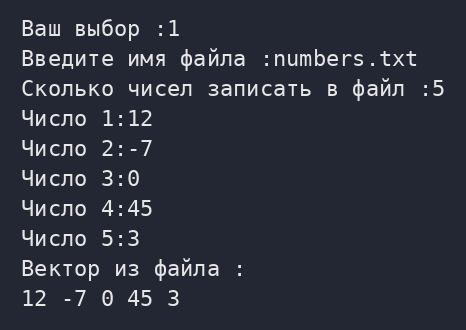
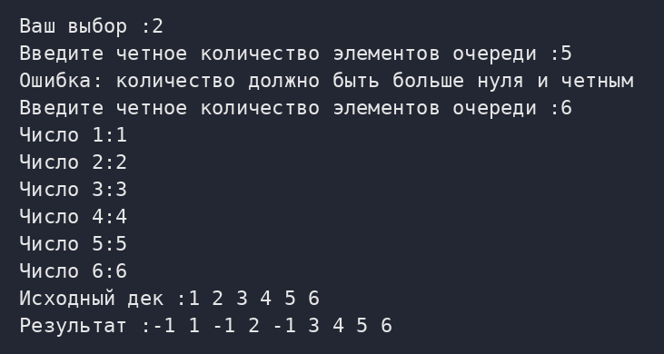
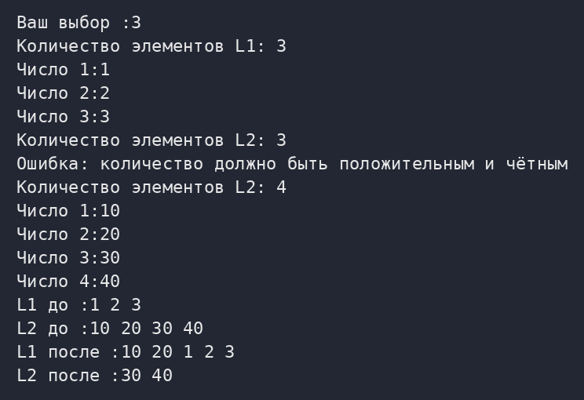
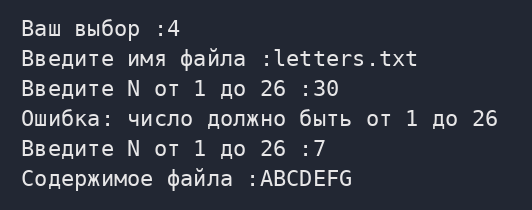
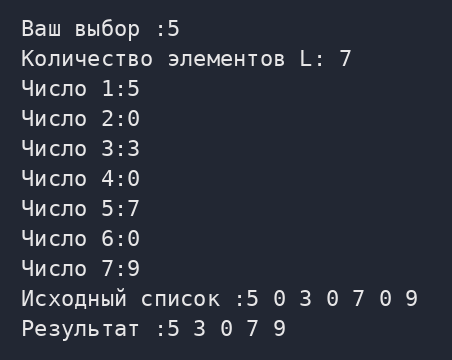
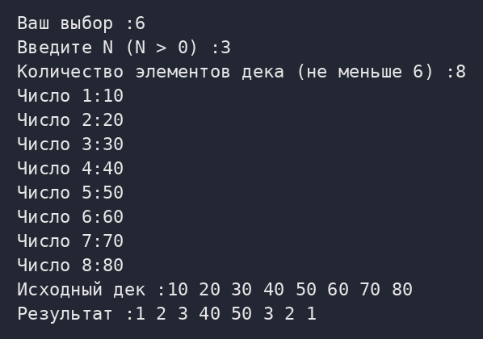
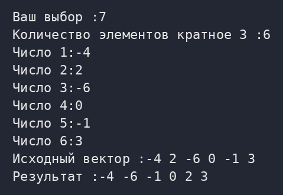
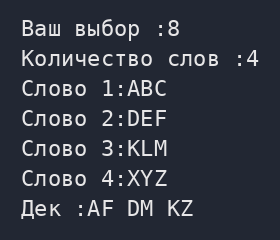
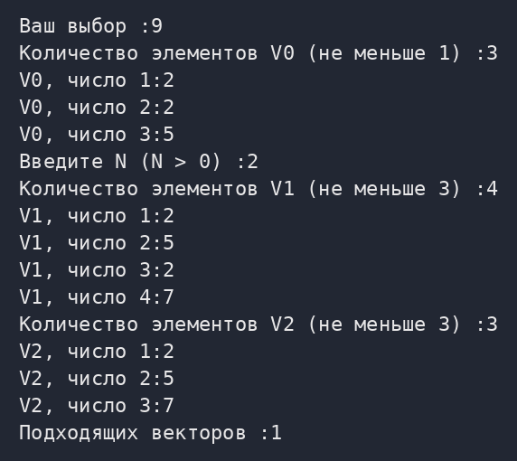
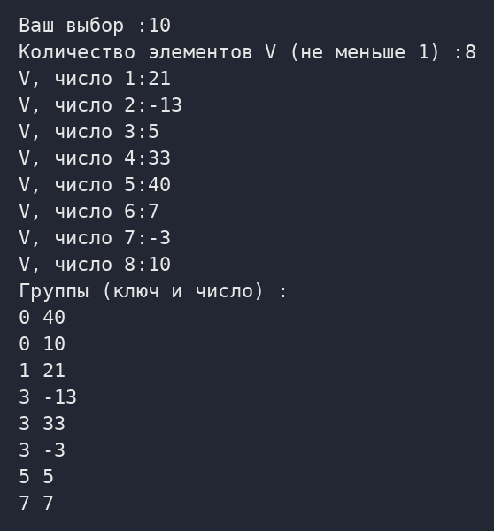

# Лабораторная работа №2. STL

Программа на C++ (вариант 3) с меню заданий 1–10. Полный отчёт со скриншотами приведён ниже в разделе «Отчёт», исходная версия отчёта лежит в папке `report/` (`.docx` и `.pdf`).

Файлы проекта: `Methods.h`, `Methods.cpp`, `main.cpp`.

Файлов сборки на VS нет, так как перешел на мак :)

## Сборка и запуск

```
g++ -std=c++20 main.cpp Methods.cpp -o lab2
./lab2
```

## Отчёт

**Денисов Кирилл 2 Лабораторная №2**

### Задание 1

#### Задача 1

##### Текст задачи

Дан текстовый файл с именем `name`, содержащий строковые представления целых чисел. Заполнить вектор V числами из исходного файла и вывести элементы вектора в исходном порядке.

Общее требование к заданию: Для заполнения контейнера использовать итератор и конструктор соответствующего контейнера, для вывода элементов использовать итератор.

##### Алгоритм решения

1. Меню (функция `Task1`) запрашивает у пользователя имя файла и числа, функция `CreateNumbersFile` записывает их в файл через пробел.

2. `MakeFileVector` открывает файл потоком `std::ifstream`. Если файл не открылся, выводится сообщение и функция завершается.

3. Вектор создаётся конструктором от пары итераторов: `istream_iterator<int>(in)` читает числа из потока, а `istream_iterator<int>()` обозначает конец ввода. Первый аргумент взят в дополнительные скобки, иначе компилятор воспримет запись как объявление функции.

4. Если поток закончился не на конце файла (`!in.eof()`), в файле встретился не-числовой текст, и выводится предупреждение. Для пустого файла выводится сообщение «Файл пуст».

5. Элементы вектора в исходном порядке выводит шаблон `PrintContainer`, который перебирает контейнер через итератор.

**Листинг 1 – Функция MakeFileVector**

```cpp
// Задание 1.1 Создать вектор и заполнить числами из файла
void MakeFileVector(const std::string& name) {
    std::ifstream in(name);
    if (!in) {
        std::cout << "Не удалось открыть файл :" << name << "\n";
        return;
    }
    std::vector<int> v((std::istream_iterator<int>(in)),
                                         std::istream_iterator<int>());
    if (!in.eof()) {
        std::cout << "Чтение завершилось не на числе \n";
    }
    if (v.empty()) {
        std::cout << "Файл пуст \n";
        return;
    }
    PrintContainer(v);
}
```

##### Тестирование



*Рисунок 1 – Задание 1, задача 1: работа программы*

*Таблица 1 – Результаты автотестов, задание 1*

| **Входные данные** | **Ожидается** | **Получено** | **Итог** |
|---|---|---|---|
| файл «12 -7 0 45 3» | `12 -7 0 45 3` | `12 -7 0 45 3` | пройден |
| файл «7» | `7` | `7` | пройден |
| пустой файл | сообщение «Файл пуст» | сообщение «Файл пуст» | пройден |
| файла нет | сообщение «Не удалось открыть файл» | сообщение «Не удалось открыть файл» | пройден |

### Задание 2

#### Задача 8

##### Текст задачи

Дан дек D с четным количеством элементов. Вставить перед каждым элементом из первой половины исходного дека число −1. Использовать функцию-член `insert` в цикле с числовым параметром.

Указание. Используйте цикл с числовым параметром, повторяющийся N/2 раз (где N — исходный размер дека). Свяжите вспомогательный итератор i с началом второй половины элементов дека. В цикле выполняйте функцию-член `insert` для первого параметра, равного --i, обязательно присваивая возвращаемое значение итератору i.

Общее требование к заданию: Для заполнения контейнера использовать итератор и конструктор соответствующего контейнера, для вывода элементов использовать итератор.

##### Алгоритм решения

1. Функция `ReadDeque` запрашивает чётное количество элементов и сами числа. Числа читаются во временный вектор, а дек создаётся конструктором от пары итераторов.

2. Итератор it ставится на начало второй половины дека: `begin()` + N / 2.

3. Цикл с числовым параметром выполняется N / 2 раз. В каждом шаге --it указывает на очередной элемент первой половины (с конца), а `insert` вставляет перед ним число −1 и возвращает итератор на вставленный элемент.

4. Возвращаемое значение присваивается обратно в it: вставка в дек делает все итераторы недействительными.

5. Вставка идёт от конца первой половины к её началу, поэтому ещё не обработанные элементы не смещаются относительно итератора.

**Листинг 2 – Функция InsertMinusOne**

```cpp
// Задание 2.8 Вставить -1 перед каждым
// эл. дека с четным кол-вом. эл.
void InsertMinusOne(std::deque<int>& deq) {
    const std::size_t size_deq = deq.size();
    std::deque<int>::iterator it = deq.begin() + size_deq / 2;
    for (std::size_t i = 0; i < size_deq / 2; ++i) {
        it = deq.insert(--it, -1);
    }
}
```

##### Тестирование



*Рисунок 2 – Задание 2, задача 8: работа программы*

*Таблица 2 – Результаты автотестов, задание 2*

| **Входные данные** | **Ожидается** | **Получено** | **Итог** |
|---|---|---|---|
| `D=[1,2,3,4]` | `[-1,1,-1,2,3,4]` | `[-1,1,-1,2,3,4]` | пройден |
| `D=[5,6]` | `[-1,5,6]` | `[-1,5,6]` | пройден |
| `D=[1,2,3,4,5,6]` | `[-1,1,-1,2,-1,3,4,5,6]` | `[-1,1,-1,2,-1,3,4,5,6]` | пройден |
| `D=[]` | `[]` | `[]` | пройден |

### Задание 3

#### Задача 6

##### Текст задачи

Даны списки `L1` и `L2`; список `L2` имеет четное количество элементов. Переместить первую половину элементов списка `L2` в начало списка `L1`. Использовать один вызов функции-члена `splice`.

Общее требование к заданию: Для заполнения контейнера использовать итератор и конструктор соответствующего контейнера, для вывода элементов использовать итератор.

##### Алгоритм решения

1. Функция `ReadList` вводит списки `L1` (любой длины) и `L2` (чётное количество элементов).

2. Итератор `middle` ставится на начало второй половины `L2` функцией `std::advance`: итераторы списка двунаправленные, поэтому выражение `begin()` + N / 2 невозможно.

3. Один вызов `splice`(позиция, источник, `first`, `last`) переносит полуинтервал [`begin`, `middle`) списка `L2` в начало `L1`.

4. `splice` не копирует значения, а перецепляет узлы списка, поэтому в `L2` остаётся только вторая половина.

**Листинг 3 – Функция InsertHalfList**

```cpp
// Задание 3.6 Перенести первую половину списка L2 в начало списка L1
void InsertHalfList(std::list<int>& list_one, std::list<int>& list_two) {
    std::list<int>::iterator middle = list_two.begin();
    std::advance(middle, list_two.size() / 2);
    list_one.splice(list_one.begin(), list_two, list_two.begin(), middle);
}
```

##### Тестирование



*Рисунок 3 – Задание 3, задача 6: работа программы*

*Таблица 3 – Результаты автотестов, задание 3*

| **Входные данные** | **Ожидается** | **Получено** | **Итог** |
|---|---|---|---|
| `L1=[1,2,3], L2=[10,20,30,40]` | `L1=[10,20,1,2,3], L2=[30,40]` | `L1=[10,20,1,2,3], L2=[30,40]` | пройден |
| `L1=[], L2=[7,8]` | `L1=[7], L2=[8]` | `L1=[7], L2=[8]` | пройден |
| `L1=[1], L2=[]` | `L1=[1], L2=[]` | `L1=[1], L2=[]` | пройден |

### Задание 4

#### Задача 9

##### Текст задачи

Дана строка `name` и целое число N (1 ≤ N ≤ 26). Записать в текстовый файл с именем `name` N начальных прописных букв латинского алфавита. Использовать алгоритм `generate_n`.

Общее требование к заданию: Обработка данных выполняется без использования контейнеров. Если алгоритм требует применения функционального объекта, следует использовать лямбда-выражения. Использовать итераторы `istream_iterator` и `ostream_iterator`.

##### Алгоритм решения

1. Меню запрашивает имя файла и число N, `ReadIntInRange` гарантирует 1 ≤ N ≤ 26.

2. Файл открывается потоком `std::ofstream`. Если он не открылся, выводится сообщение об ошибке.

3. Контейнеры не используются. Алгоритм `generate_n` вызывает функциональный объект N раз и записывает результаты через выходной итератор `ostream_iterator<char>`, привязанный к файлу.

4. Функциональный объект – лямбда-выражение [&`letter`]: она захватывает переменную `letter` по ссылке и при каждом вызове возвращает текущую букву, увеличивая её на единицу (A, B, C, …).

5. После записи меню открывает файл и выводит его содержимое.

**Листинг 4 – Функция WriteLatineInFile**

```cpp
// Задание 4.9 Записать в файл N латинских букв
void WriteLatineInFile(const std::string& name, int number) {
    std::ofstream out(name);
    if (!out) {
        std::cout << "Ошибка: не удалось создать файл " << name << "\n";
        return;
    }
    char letter = 'A';
    std::generate_n(std::ostream_iterator<char>(out), number,
                                    [&letter]() { return letter++; });
}
```

##### Тестирование



*Рисунок 4 – Задание 4, задача 9: работа программы*

*Таблица 4 – Результаты автотестов, задание 4*

| **Входные данные** | **Ожидается** | **Получено** | **Итог** |
|---|---|---|---|
| `N=5` | `ABCDE` | `ABCDE` | пройден |
| `N=1` | `A` | `A` | пройден |
| `N=26` | `ABCDEFGHIJKLMNOPQRSTUVWXYZ` | `ABCDEFGHIJKLMNOPQRSTUVWXYZ` | пройден |

### Задание 5

#### Задача 3

##### Текст задачи

Дан список L. Удалить первый и последний нулевой элемент списка. Если нулевых элементов нет, то список не изменять, если нулевой элемент всего один, то удалить только его. Использовать два вызова алгоритма `find` и два вызова функции-члена `erase`.

Указание. Имеющуюся в классе `list` функцию-член `remove` в данном случае использовать нельзя, так как она удаляет все элементы с определенным значением. См. также указание к задаче 5.2.

##### Алгоритм решения

1. Функция `ReadList` вводит список L.

2. Первый вызов `find` по прямым итераторам ищет первый нуль. Если нуля нет, функция завершается и список не меняется.

3. Второй вызов `find` по обратным итераторам (`rbegin`, `rend`) ищет последний нуль. Обратный итератор указывает на элемент левее своего `base()`, поэтому `(++rev).base()` даёт обычный итератор именно на найденный элемент.

4. Первый вызов `erase` удаляет последний нуль. Второй вызов удаляет первый нуль, но только если это другой элемент (`first_zero` != `last_zero`): если нуль один, удаляется только он.

5. У списка удаление одного узла не делает недействительными итераторы на другие, поэтому порядок удаления безопасен. Функцию-член `remove` использовать нельзя: она удалила бы все нули.

**Листинг 5 – Функция DeleteZero**

```cpp
// Задание 5.3 Удаление первого и последнего нулевого эл. списка
void DeleteZero(std::list<int>& our_list) {
    std::list<int>::iterator first_zero =
            std::find(our_list.begin(), our_list.end(), 0);
    if (first_zero == our_list.end()) {
        return;
    }
    std::list<int>::reverse_iterator rev =
            std::find(our_list.rbegin(), our_list.rend(), 0);
    std::list<int>::iterator last_zero = (++rev).base();
    our_list.erase(last_zero);
    if (first_zero != last_zero) {
        our_list.erase(first_zero);
    }
}
```

##### Тестирование



*Рисунок 5 – Задание 5, задача 3: работа программы*

*Таблица 5 – Результаты автотестов, задание 5*

| **Входные данные** | **Ожидается** | **Получено** | **Итог** |
|---|---|---|---|
| `L=[5,0,3,0,7,0,9]` | `[5,3,0,7,9]` | `[5,3,0,7,9]` | пройден |
| L=[1,2,3] (нулей нет) | `[1,2,3]` | `[1,2,3]` | пройден |
| L=[1,0,2] (один нуль) | `[1,2]` | `[1,2]` | пройден |
| `L=[0,0]` | `[]` | `[]` | пройден |
| `L=[0,4,5,0]` | `[4,5]` | `[4,5]` | пройден |

### Задание 6

#### Задача 3

##### Текст задачи

Дано число N (> 0) и дек D, содержащий не менее 2N элементов. Заполнить первые N элементов дека последовательностью чисел 1, 2, …, N, а последние N элементов дека — последовательностью N, N−1, …, 2, 1. Использовать два вызова алгоритма `generate` с одинаковым параметром — функциональным объектом, а также обратные итераторы.

##### Алгоритм решения

1. Меню запрашивает N (N > 0) и дек минимум из 2N элементов (`ReadDequeAtLeast`).

2. Лямбда `next` захватывает счётчик `start` по значению и объявлена `mutable`, чтобы изменять свою копию: каждый вызов возвращает ++`start`.

3. Алгоритм `generate` принимает функциональный объект по значению, поэтому каждому из двух вызовов достаётся своя копия со счётчиком, начинающимся с нуля, и обе последовательности начинаются с единицы.

4. Первый вызов `generate`(`begin`, `begin` + N, `next`) заполняет первые N элементов числами 1, 2, …, N.

5. Второй вызов `generate`(`rbegin`, `rbegin` + N, `next`) идёт с конца дека обратными итераторами: последний элемент получает 1, предпоследний – 2 и так далее, поэтому в прямом порядке последние N элементов равны N, …, 2, 1.

**Листинг 6 – Функция InsertNumbersInDeq**

```cpp
// Задание 6.3 Перезаписывает N эл. дек с начала и конца
void InsertNumbersInDeq(std::deque<int>& deq, int count) {
    int start = 0;
    auto next = [start]() mutable { return ++start; };
    std::generate(deq.begin(), deq.begin() + count, next);
    std::generate(deq.rbegin(), deq.rbegin() + count, next);
}
```

##### Тестирование



*Рисунок 6 – Задание 6, задача 3: работа программы*

*Таблица 6 – Результаты автотестов, задание 6*

| **Входные данные** | **Ожидается** | **Получено** | **Итог** |
|---|---|---|---|
| `N=3, D=[10..80]` | `[1,2,3,40,50,3,2,1]` | `[1,2,3,40,50,3,2,1]` | пройден |
| `N=1, D=[9,9]` | `[1,1]` | `[1,1]` | пройден |
| `N=2, D=[0,0,0,0]` | `[1,2,2,1]` | `[1,2,2,1]` | пройден |

### Задание 7

#### Задача 13

##### Текст задачи

Дан вектор V, количество элементов которого делится на 3. Известно, что каждая треть вектора уже упорядочена по возрастанию. Решить для исходного вектора задачу 7.7, используя два вызова алгоритма `inplace_merge` с одним и тем же параметром — функциональным объектом.

Условие задачи 7.7, на которую ссылается условие: Дан список L. Перегруппировать элементы списка, расположив в нём вначале отрицательные, затем нулевые, а затем положительные элементы (порядок расположения элементов в каждой группе должен совпадать с исходным). Использовать два вызова алгоритма `stable_partition`.

##### Алгоритм решения

1. Функция `ReadThirds` вводит вектор, размер которого кратен 3, и проверяет, что внутри каждой трети числа идут по возрастанию.

2. Каждая треть упорядочена, значит, в ней уже идут отрицательные числа, затем нули, затем положительные. Если слить трети по знаку числа, получится нужное расположение.

3. Функциональный объект – лямбда `by_sign`: она сравнивает не сами числа, а их знаки (`Sign` возвращает −1, 0 или 1).

4. `inplace_merge` устойчив: равные по знаку элементы сохраняют исходный порядок, причём элементы первого диапазона идут перед элементами второго.

5. Первый вызов сливает первую и вторую трети, второй вызов сливает результат с последней третью. Оба вызова используют один и тот же `by_sign`.

**Листинг 7 – Функции Sign и SortVectorBySign**

```cpp
// Знак числа: -1, 0 или 1.
int Sign(int x) {
    return (x > 0) - (x < 0);
}
```

// Задание 7.13 сортировка вектора по третям

`void` `SortVectorBySign`(`std::vector<int>`& v) {

`const` `std::size_t` `third` = `v.size()` / 3;

`auto` `by_sign` = [](`int` a, `int` b) { `return` `Sign(a)` < `Sign(b)`; };

`std::inplace_merge`(`v.begin()`, `v.begin()` + `third`, `v.begin()` + 2 * `third`,

`by_sign`);

`std::inplace_merge`(`v.begin()`, `v.begin()` + 2 * `third`, `v.end()`, `by_sign`);

}

##### Тестирование



*Рисунок 7 – Задание 7, задача 13: работа программы*

*Таблица 7 – Результаты автотестов, задание 7*

| **Входные данные** | **Ожидается** | **Получено** | **Итог** |
|---|---|---|---|
| `V=[-4,2,-6,0,-1,3]` | `[-4,-6,-1,0,2,3]` | `[-4,-6,-1,0,2,3]` | пройден |
| `V=[1,2,3,4,5,6]` | `[1,2,3,4,5,6]` | `[1,2,3,4,5,6]` | пройден |
| V — только отрицательные | `[-3,-2,-1,-6,-5,-4,-9,-8,-7]` | `[-3,-2,-1,-6,-5,-4,-9,-8,-7]` | пройден |
| `V=[-2,0,5,-3,0,4,-1,0,6]` | `[-2,-3,-1,0,0,0,5,4,6]` | `[-2,-3,-1,0,0,0,5,4,6]` | пройден |

### Задание 8

#### Задача 2

##### Текст задачи

Дан список L, элементами которого являются английские слова. Получить дек D со строковыми элементами, каждый из которых строится по паре соседних элементов исходного списка L следующим образом: последняя буква правого элемента пары приписывается справа к первой букве левого элемента пары. Количество элементов дека D должно быть на 1 меньше количества элементов списка L. Например, для исходного списка `ABC`, `DEF`, `KLM`, `XYZ` полученный дек должен содержать строки AF, DM, KZ. Использовать алгоритм `adjacent_difference` с итератором вставки и функциональным объектом, а также функцию-член `erase` для дека D.

##### Алгоритм решения

1. Функция `ReadWords` вводит список слов и проверяет, что слова состоят только из латинских букв.

2. `adjacent_difference` вызывает функциональный объект для каждой пары соседних элементов: первым аргументом идёт текущий (правый) элемент, вторым – предыдущий (левый).

3. Лямбда строит строку: первая буква левого слова и справа приписанная последняя буква правого слова.

4. Результаты записываются в дек через итератор вставки `back_inserter`.

5. Первым элементом результата алгоритм всегда записывает копию первого слова, которая не нужна, поэтому она удаляется вызовом `erase`(`pairs.begin()`). Размер дека получается на 1 меньше размера списка.

**Листинг 8 – Функция MakeWordPairs**

```cpp
// Задание 8.2 Построить дек строк по парам соседних слов списка
std::deque<std::string> MakeWordPairs(const std::list<std::string>& words) {
    std::deque<std::string> pairs;
    std::adjacent_difference(
            words.begin(), words.end(), std::back_inserter(pairs),
            [](const std::string& right, const std::string& left) {
                return std::string(1, left.front()) + right.back();
            });
    if (!pairs.empty()) {
        pairs.erase(pairs.begin());
    }
    return pairs;
}
```

##### Тестирование



*Рисунок 8 – Задание 8, задача 2: работа программы*

*Таблица 8 – Результаты автотестов, задание 8*

| **Входные данные** | **Ожидается** | **Получено** | **Итог** |
|---|---|---|---|
| `L=[ABC,DEF,KLM,XYZ]` | `[AF,DM,KZ]` | `[AF,DM,KZ]` | пройден |
| `L=[AB,CD]` | `[AD]` | `[AD]` | пройден |
| `L=[HELLO]` | `[]` | `[]` | пройден |
| `L=[]` | `[]` | `[]` | пройден |

### Задание 9

#### Задача 2

##### Текст задачи

Дан вектор `V0`, целое число N (> 0) и набор векторов `V1`, …, VN. Известно, что размер вектора `V0` не превосходит размера любого из векторов `V1`, …, VN. Найти количество векторов VI, I = 1, …, N, в которых содержатся все элементы вектора `V0` (с учетом их повторений). Использовать алгоритм `includes`, применяя его в цикле к двум мультимножествам (контейнерам типа `multiset`), одно из которых создано на основе вектора `V0`, а другое на очередной итерации содержит элементы очередного из векторов VI, I = 1, …, N.

##### Алгоритм решения

1. Вводятся вектор `V0`, число N и N векторов; функция `ReadVectorSet` проверяет, что каждый вектор не короче `V0`.

2. Из `V0` один раз строится мультимножество `set0`.

3. В цикле по векторам из очередного вектора создаётся мультимножество `current`.

4. `includes`(`current`, `set0`) возвращает `true`, если каждый элемент `set0` есть в `current` столько раз, сколько он встречается в `set0`. Алгоритму нужны упорядоченные диапазоны, а `multiset` хранит элементы упорядоченно и допускает повторы.

5. Счётчик увеличивается для каждого подходящего вектора. Например, при `V0` = (2, 2, 5) вектору (2, 5, 7) не хватает одной двойки, поэтому он не считается.

**Листинг 9 – Функция CountVectorsWithAll**

```cpp
// Задание 9.2 Кол-ва. векторов содержащих все элементы V0 с повторениями
int CountVectorsWithAll(
        const std::vector<int>& vec0,
        const std::vector<std::vector<int>>& vectors) {
    const std::multiset<int> set0(vec0.begin(), vec0.end());
    int count = 0;
    for (std::vector<std::vector<int>>::const_iterator it = vectors.begin();
             it != vectors.end(); ++it) {
        const std::multiset<int> current(it->begin(), it->end());
        if (std::includes(current.begin(), current.end(),
                                            set0.begin(), set0.end())) {
            ++count;
        }
    }
    return count;
}
```

##### Тестирование



*Рисунок 9 – Задание 9, задача 2: работа программы*

*Таблица 9 – Результаты автотестов, задание 9*

| **Входные данные** | **Ожидается** | **Получено** | **Итог** |
|---|---|---|---|
| `V0=[2,2,5]; V1..V3` | `2` | `2` | пройден |
| `V0=[1]; [1],[2],[3,1]` | `2` | `2` | пройден |
| `V0=[4,4]; [4,5],[5,5]` | `0` | `0` | пройден |
| `V0=[3]; [3,3,3]` | `1` | `1` | пройден |

### Задание 10

#### Задача 3

##### Текст задачи

Дан вектор V. Выполнить группировку элементов вектора V, используя в качестве ключа группировки последнюю (т. е. правую) цифру элемента: в одну группу должны входить все элементы вектора V, оканчивающиеся на одну и ту же цифру (сгруппированные элементы должны располагаться в том же порядке, в котором они располагались в исходном векторе). Представить результат группировки в виде мультиотображения M (класса `multimap`), ключами которого являются ключи группировки, т. е. последние цифры элементов вектора V, а значениями — элементы вектора, оканчивающиеся на соответствующую цифру (таким образом, отображение M должно иметь тип `multimap`<`int`, `int`>). Вывести полученное отображение (для каждого элемента отображения M вначале выводить ключ, а затем связанный с ним элемент вектора V; ключи могут повторяться). Для перебора элементов контейнеров использовать циклы с параметрами-итераторами.

##### Алгоритм решения

1. Функция `ReadVectorAtLeast` вводит вектор V.

2. Вектор перебирается циклом с итератором. Каждый элемент вставляется в `multimap`<`int`, `int`> парой (последняя цифра, элемент).

3. Последняя цифра вычисляется как `abs`(x % 10): для отрицательных чисел остаток от деления в C++ отрицателен, поэтому берётся модуль.

4. Мультиотображение допускает повторяющиеся ключи, упорядочивает пары по ключу, а равные ключи хранит в порядке вставки, поэтому порядок элементов внутри группы совпадает с исходным.

5. `PrintMultimap` выводит ключ и значение каждого элемента циклом с итератором.

**Листинг 10 – Функции GroupByLastDigit и PrintMultimap**

```cpp
// Задание 10.3 Группировка эл. вектора по последней цифре
std::multimap<int, int> GroupByLastDigit(const std::vector<int>& vec) {
    std::multimap<int, int> groups;
    for (std::vector<int>::const_iterator it = vec.begin(); it != vec.end();
             ++it) {
        groups.insert(std::make_pair(std::abs(*it % 10), *it));
    }
    return groups;
}
```

// Вывод мультиотображения ключ затем значение

`void` `PrintMultimap`(`const` `std::multimap`<`int`, `int`>& `groups`) {

`for` (`std::multimap`<`int`, `int`>::`const_iterator` it = `groups.begin()`;

it != `groups.end()`; ++it) {

`std::cout` << it->`first` << ' ' << it->`second` << "\n";

}

}

##### Тестирование



*Рисунок 10 – Задание 10, задача 3: работа программы*

*Таблица 10 – Результаты автотестов, задание 10*

| **Входные данные** | **Ожидается** | **Получено** | **Итог** |
|---|---|---|---|
| `V=[21,-13,5,33,40,7,-3,10]` | `{0:40,0:10,1:21,3:-13,3:33,3:-3,5:5,7:7}` | `{0:40,0:10,1:21,3:-13,3:33,3:-3,5:5,7:7}` | пройден |
| `V=[11,21,31]` | `{1:11,1:21,1:31}` | `{1:11,1:21,1:31}` | пройден |
| `V=[0]` | `{0:0}` | `{0:0}` | пройден |
| `V=[-10,10,-5]` | `{0:-10,0:10,5:-5}` | `{0:-10,0:10,5:-5}` | пройден |
